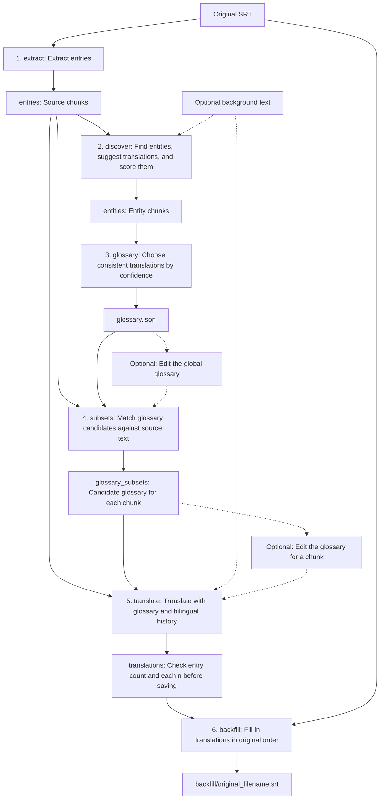

[简体中文](README.md) | [English](README.en.md)

# SRT Subtitle Translator

## Introduction

A command line tool for translating SRT subtitles through an API compatible with OpenAI. The default target language is Simplified Chinese (`zh-Hans`).

- No fixed list of source or target languages; language support depends on the model.
- Translate in chunks of subtitle entries, using preceding bilingual history to maintain context.
- Automatically extract terms and keep translations consistent. Add, delete, or edit glossary entries.
- Provide background information, character relationships, and style requirements to guide translation.
- Inspect and edit intermediate files, and reuse them to resume interrupted tasks.

## Usage

### Installation

The portable version currently supports Windows x64 only. Download `srt-translate-windows-x64.zip` from [Releases](https://github.com/chansey97/srt-translate/releases) and extract the entire archive. No Python installation is required.

Open PowerShell in the extracted application directory to view the help:

```powershell
.\srt-translate.exe --help
```

Linux users can [install from source](#installing-from-source).

### Configuration

The API service and model must support OpenAI Chat Completions and `json_schema` structured output.

Edit `config.toml` next to the executable. Replace the default API endpoint, key, and model with the values supplied by your service provider:

```toml
[openai]
base_url = "http://127.0.0.1:8317/v1"
api_key = "123456"
model = "gemini-3.8-flash-high"
max_retries = 2
```

`max_retries` sets the maximum number of retries after a failed request; `0` disables retries. Use `--config-file PATH` to supply another configuration file that overrides these settings by field.

### CLI Options

```text
.\srt-translate.exe INPUT_SRT --source-lang LANG [OPTIONS]
```

`LANG` uses BCP 47 language tags, such as `en` (English), `ja` (Japanese), `zh-Hans` (Simplified Chinese), and `zh-Hant` (Traditional Chinese).

| Argument or option | Default | Description |
| --- | --- | --- |
| `INPUT_SRT` | Required | Path to the original SRT file |
| `--source-lang LANG` | Required | Source language |
| `--target-lang LANG` | `zh-Hans` | Target language |
| `--background PATH` | None | UTF-8 text with background information and style requirements |
| `--output-dir PATH` | Current working directory | Output parent directory in which the task directory is created |
| `--config-file PATH` | None | Configuration override file with the highest priority |
| `--input-encoding NAME` | `utf-8-sig` | Source SRT encoding; the default supports UTF-8 with or without a BOM |
| `--chunk-size N` | `20` | Number of subtitle entries per chunk; must be positive |
| `--history-size N` | `5` | Number of preceding bilingual subtitle entries to reference; `0` disables history |
| `--no-translate-glossary` | Disabled | Keep terms in their original spelling when the model determines they apply |
| `--delay-between-requests SECONDS` | `0` | Wait before every model call, including the first; accepts nonnegative decimals |
| `--from-stage NAME` | `extract` | First stage to run, inclusive |
| `--to-stage NAME` | `backfill` | Last stage to run, inclusive |
| `-h` / `--help` | — | Show help |

The stages run in this order: `extract → discover → glossary → subsets → translate → backfill`. All stages run by default. When a range is specified, earlier stages are not run automatically.

### Typical Workflow

Start by translating `input.srt` from English into Simplified Chinese:

```powershell
.\srt-translate.exe input.srt --source-lang en
```

The tool creates an `input__en_to_zh-Hans/` task directory in the current working directory. The final subtitles are saved to `input__en_to_zh-Hans/backfill/input.srt`; the original file is unchanged.

If you are unhappy with the translation of a name or term, open `glossary.json` in the task directory. The glossary uses a `"source term": "translation"` format. You can add, delete, or edit entries, for example:

```json
{
  "Elias": "伊莱亚斯",
  "Alexia": "Alexia"
}
```

Using the same key and value keeps the original term. After saving your edits, delete the `glossary_subsets/`, `translations/`, and `backfill/` directories inside this task directory, then run the original command again:

```powershell
.\srt-translate.exe input.srt --source-lang en
```

The tool reuses existing files and your edited glossary, then regenerates the glossary subsets, translations, and final subtitles. You can also rerun the original command to resume an interrupted task.

Task directories are named `<stem>__<source_lang>_to_<target_lang>/`. Use `--output-dir` to choose their output parent directory. Relative paths are resolved from the current working directory, so keep the directory and arguments consistent when resuming. Use separate output parent directories for subtitles from different locations that share the same filename.

## How It Works

Subtitles pass through six stages. Entity discovery and translation call the model; the other stages run locally.



## Development

See [PLAN.md](https://github.com/chansey97/srt-translate/blob/main/PLAN.md) (in Chinese) for implementation details, intermediate file conventions, and build environment setup.

### Installing from Source

Requires Git and Python 3.11 or later. Clone the repository and enter its directory:

```text
git clone https://github.com/chansey97/srt-translate.git
cd srt-translate
```

Create and activate a virtual environment, then install the project and test dependencies. On Linux:

```bash
python3 -m venv .venv
source .venv/bin/activate
python -m pip install -e ".[dev]"
```

On Windows PowerShell:

```powershell
python -m venv .venv
.\.venv\Scripts\Activate.ps1
python -m pip install -e ".[dev]"
```

After installing from source, use `srt-translate` in place of `.\srt-translate.exe` in the examples. Create a `config.toml` using the configuration example above, and select it with `--config-file PATH` when running the tool.

### Building the Windows x64 Portable Version

Once the build environment is ready, run this command from the project root:

```powershell
.\build_portable.bat
```

After a successful build, the application directory and ZIP archive are in `dist/`.

### Testing

After installing from source, run:

| Command | Description |
| --- | --- |
| `python -m pytest` | Default tests; no API requests |
| `python -m pytest tests/portable` | Portable tests; requires a built ZIP and does not connect to a real API |
| `python -m pytest tests/live` | Live API tests; loads built-in and system user configuration, and saves outputs to `test_outputs/live/` |
