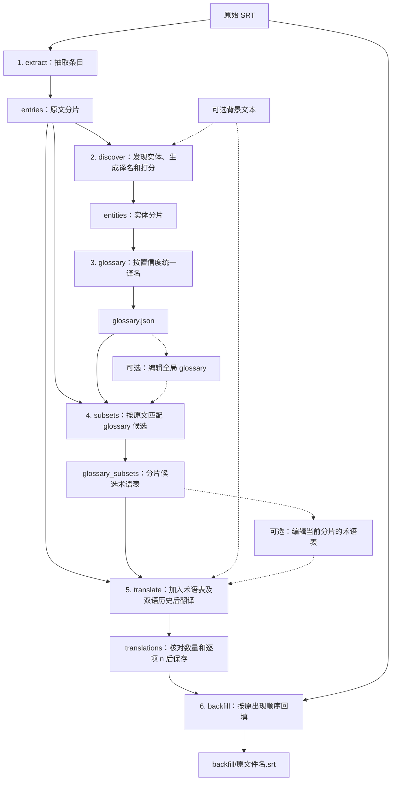

[简体中文](README.md) | [English](README.en.md)

# SRT 字幕翻译工具

## 介绍

通过 OpenAI 兼容接口翻译 SRT 字幕的命令行工具，默认译为简体中文（`zh-Hans`）。

- 不限定源语言和目标语言，实际翻译能力取决于所用模型。
- 按字幕条数分片，支持参考前文的双语历史，保持上下文连贯。
- 自动提取术语并统一译名，支持在词汇表中新增、删除词条或修改译名。
- 可提供作品背景、人物关系和文风要求，辅助翻译。
- 保留可查看、可编辑的中间产物；中断后可复用已有产物续跑。

## 用法

### 安装

Portable 目前仅支持 Windows x64。从 [Releases](https://github.com/chansey97/srt-translate/releases) 下载 `srt-translate-windows-x64.zip`，完整解压即可使用，无需安装 Python。

在解压后的应用目录打开 PowerShell，查看帮助：

```powershell
.\srt-translate.exe --help
```

Linux 用户请参考[从源码安装](#从源码安装)。

### 配置

API 服务和模型需支持 OpenAI Chat Completions 及 `json_schema` 结构化输出。

编辑 exe 同目录的 `config.toml`，将默认配置中的接口地址、密钥和模型改为服务提供的信息：

```toml
[openai]
base_url = "http://127.0.0.1:8317/v1"
api_key = "123456"
model = "gemini-3.8-flash-high"
max_retries = 2
```

`max_retries` 为请求失败后的最大重试次数，`0` 表示不重试。也可通过 `--config-file PATH` 指定配置文件，按字段覆盖上述配置。

### CLI 参数

```text
.\srt-translate.exe INPUT_SRT --source-lang LANG [OPTIONS]
```

`LANG` 使用 BCP 47 语言标签，如 `en`（英语）、`ja`（日语）、`zh-Hans`（简体中文）、`zh-Hant`（繁体中文）。

| 参数 | 默认值 | 说明 |
| --- | --- | --- |
| `INPUT_SRT` | 必填 | 原始 SRT 路径 |
| `--source-lang LANG` | 必填 | 源语言 |
| `--target-lang LANG` | `zh-Hans` | 目标语言 |
| `--background PATH` | 不提供 | UTF-8 背景文本，可包含作品信息和文风要求 |
| `--output-dir PATH` | 当前工作目录 | 输出父目录，程序在其中创建任务目录 |
| `--config-file PATH` | 不提供 | 配置覆盖文件，优先级最高 |
| `--input-encoding NAME` | `utf-8-sig` | 原 SRT 编码，默认兼容带 BOM 和不带 BOM 的 UTF-8 |
| `--chunk-size N` | `20` | 每片字幕条数，正整数 |
| `--history-size N` | `5` | 参考的前文双语字幕条数，`0` 禁用 |
| `--no-translate-glossary` | 不启用 | 将模型确认适用的候选术语保留原词 |
| `--delay-between-requests SECONDS` | `0` | 每次模型调用前的等待秒数，含第一次；支持非负小数 |
| `--from-stage NAME` | `extract` | 起始阶段，包含该阶段 |
| `--to-stage NAME` | `backfill` | 结束阶段，包含该阶段 |
| `-h` / `--help` | — | 显示帮助 |

阶段顺序为 `extract → discover → glossary → subsets → translate → backfill`。默认执行全部阶段；指定区间时，不补跑前置阶段。

### 典型用法

先将 `input.srt` 从英语翻译为简体中文：

```powershell
.\srt-translate.exe input.srt --source-lang en
```

程序在当前工作目录创建 `input__en_to_zh-Hans/` 任务目录，最终字幕位于 `input__en_to_zh-Hans/backfill/input.srt`，原字幕文件保持不变。

如果对人名或术语译名不满意，打开任务目录中的 `glossary.json`。词汇表采用 `"原词": "译名"` 格式，可新增、删除词条或修改译名，例如：

```json
{
  "Elias": "伊莱亚斯",
  "Alexia": "Alexia"
}
```

键和值相同表示保留原词。保存后，删除该任务目录中的 `glossary_subsets/`、`translations/` 和 `backfill/` 三个目录，再运行原命令：

```powershell
.\srt-translate.exe input.srt --source-lang en
```

程序会复用已有产物和编辑后的词汇表，重新生成词汇表子集、译文和最终字幕。任务中断后，也可用原命令续跑。

任务目录名为 `<stem>__<source_lang>_to_<target_lang>/`，可用 `--output-dir` 指定其输出父目录。相对路径均基于当前工作目录，续跑时请保持目录和参数一致；不同来源的同名字幕请使用不同的输出父目录。

## 工作原理

字幕依次经过六个阶段，实体发现和翻译调用模型，其余阶段在本地完成。



## 开发

实现方案、产物约定和构建环境准备详见仓库中的 [PLAN.md](https://github.com/chansey97/srt-translate/blob/main/PLAN.md)。

### 从源码安装

需要 Git 和 Python 3.11 或以上版本。克隆仓库并进入项目目录：

```text
git clone https://github.com/chansey97/srt-translate.git
cd srt-translate
```

创建并激活虚拟环境，安装项目和测试依赖。Linux：

```bash
python3 -m venv .venv
source .venv/bin/activate
python -m pip install -e ".[dev]"
```

Windows PowerShell：

```powershell
python -m venv .venv
.\.venv\Scripts\Activate.ps1
python -m pip install -e ".[dev]"
```

源码安装后，使用 `srt-translate` 替代示例中的 `.\srt-translate.exe`。按上面的配置示例创建 `config.toml`，运行时通过 `--config-file PATH` 指定。

### 构建 Windows x64 portable

准备好构建环境后，在项目根目录执行：

```powershell
.\build_portable.bat
```

构建成功后，应用目录和 ZIP 包位于 `dist/`。

### 测试

完成源码安装后运行：

| 命令 | 说明 |
| --- | --- |
| `python -m pytest` | 默认测试，不发送 API 请求 |
| `python -m pytest tests/portable` | Portable 测试，需先构建 ZIP，不连接真实 API |
| `python -m pytest tests/live` | 真实 API 测试，读取内置配置和系统用户配置，产物保存在 `test_outputs/live/` |
